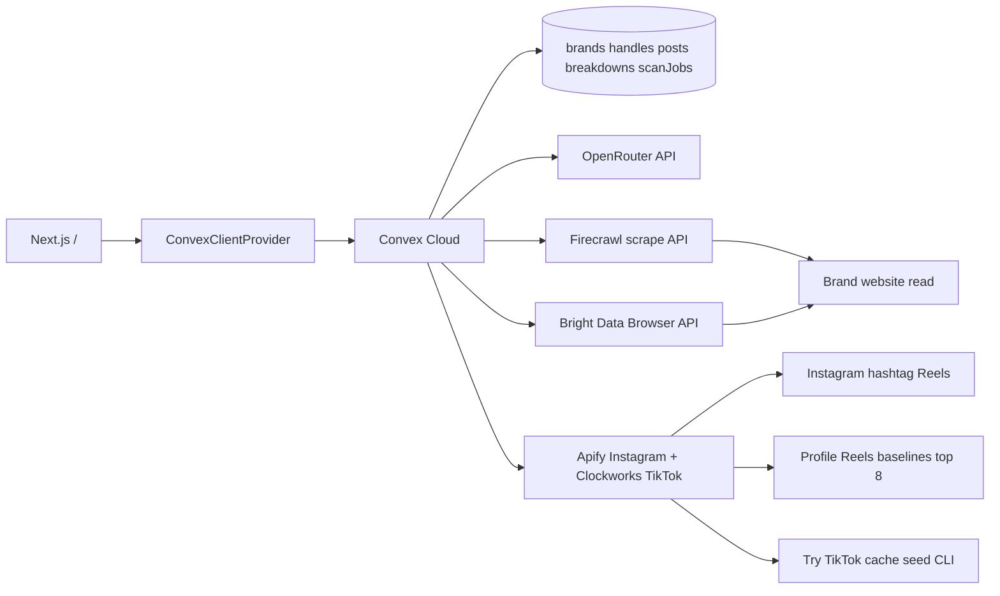

# Viralradar: live operation

Operational reference for this Next.js + Convex app.  
Local dev: [README.md](../README.md). Session history: [JOURNAL.md](JOURNAL.md).

## Current state

| Item | Value |
|------|--------|
| Path | `c:\flutter_apps\viralradar` |
| Org / repo | [sid-kiwilab/viralradar](https://github.com/sid-kiwilab/viralradar) |
| Product | **Viral Radar**: winning organic formats in a niche that AI can recreate |
| Domain | unset |
| Stack | Next.js 16, React 19, Tailwind 4, Convex, `playwright-core` (remote CDP), OpenRouter (`openai` SDK) |
| App root | `app/` (no `src/`) |
| Dev server | `npm run dev` or [`start.bat`](../start.bat) → **owner** verifies in browser. Agent never opens or fetches localhost. |
| Routes | `/`, `/how-it-works`, `/post/[postId]` (cached structural brief) |
| Backend | Convex Cloud (`convex/`) |
| LLM | OpenRouter → default `anthropic/claude-sonnet-4.6` ([`convex/lib/openrouter.ts`](../convex/lib/openrouter.ts)); optional `OPENROUTER_MODEL` on Convex |
| Scraper | Brand sites: **Firecrawl** scrape first, Bright Data Browser fallback. Live scan: **Apify** hashtag Reels + **profile Reels baselines** (`instagram-hashtag-scraper`, `instagram-scraper`). Try **Fast scan**: cached TikTok (seed via dev CLI). |
| Production URL | unset |

### Git (this repo only)

| Setting | Value |
|---------|--------|
| Branch | `main` |
| `origin` | `github.com/sid-kiwilab/viralradar` |
| Local user | `sid-kiwilab` / `sid@kiwilab.ai` |

---

## Architecture



- **Home** ([`app/home-client.tsx`](../app/home-client.tsx)): URL in → live niche Reels scan (no confirm screens). Optional **Exclude Instagram handles** (comma-separated) on [`scanJobs.excludeHandles`](../convex/schema.ts); empty = no exclusions. **Fast scan** on Try hosts reopens a completed job when any posts exist (including views-only). Status chips: Site → Niche → Reels → Score. Hashtags/keywords show while running. List: **≥ 2×** pill, else **Views only** on Instagram search hits; empty copy uses [`instagramSearchSummary`](../convex/posts.ts) when niche Reels exist but none qualify. Instagram and TikTok lightboxes on Play.
- **Scan job patches** ([`convex/scanJobs.ts`](../convex/scanJobs.ts)): internal **`patch`** and **`markRunning`** no-op when job is already `failed` or `completed` (stale actions after cancel/rescan).
- **Scan pipeline** ([`convex/actions/scanBrand.ts`](../convex/actions/scanBrand.ts)): live path `understand_site` → `find_niche_queries` → `search_reels` (hashtag Reels) → [`scrapeHandleBaselines`](../convex/actions/scanBrand.ts) (top 8 handles, profile Reels grid) → `score` → `done`. Baseline pass is a **scheduled second action** (separate Convex action window). [`abandonScan`](../convex/scanJobs.ts) cancels. **`isJobActive`** after long awaits.
- **Site read**: one Firecrawl scrape (~25s cap, markdown + links) when `FIRECRAWL_API_KEY` is set; on quota, timeout, unreadable body, or missing key → Bright Data Browser (cookie-banner block, captcha wait, one retry). Page text only (no raw `fetch` of the brand URL). Brand understanding uses prompt **`brand-infer-v4`** ([`discovery/brandFromUrl.ts`](../convex/discovery/brandFromUrl.ts)): service, products, audience, `notThis`, plus name/niche/positioning on [`brands`](../convex/schema.ts). Each run also inserts a row in **`brandInferences`** when the scan job is still active (versioned raw output + page excerpt + **`pageReadMs` / `inferMs` / `understandMs`**; survives [`purgeBrandScan`](../convex/lib/purgeBrandScan.ts); shown via public [`latestByJob`](../convex/brandInferences.ts) — parsed fields + timings only, not raw model JSON).
- **Niche Reels**: After infer, [`inferNicheSearchQueries`](../convex/discovery/nicheSearchQueries.ts) writes **`niche-search-v3`** hashtags + keywords from *that* brand's category (any DTC). Keep a Reel only if caption/tags match those queries **and** the category's product-form words. Skip Reels whose owner is on the job's optional [`excludeHandles`](../convex/lib/excludeHandles.ts) list (user-supplied at Scan). Then profile baselines for the top 8 handles.
- **Try TikTok cache** (Fast scan only, not live Scan): dev CLI [`seedTryTikTokCaches`](../convex/demoCache.ts) / `seedTryTikTokCacheByHost` schedules [`seedTryTikTok`](../convex/actions/scanBrand.ts) — Clockworks **latest + popular** profile passes for the mapped `@handle` ([`TRY_TIKTOK_HANDLE_BY_HOST`](../lib/demo-brands.ts)). Covers stored at scrape ([`storeThumbnail.ts`](../convex/lib/storeThumbnail.ts)); reopen schedules [`backfillForBrand`](../convex/actions/thumbnails.ts) for legacy rows.
- **Scoring**: per-handle median of up to 24 most recent scraped posts (search + profile) when ≥5 on that account; **no mixed-set fallback**. `outlierScore` = views / baseline only then. Home lists **search** Reels only (`posts.origin`: `search` | `profile`; profile rows feed the median only): **≥ 2×** first (by multiplier), then **Views only**. Brand post reads use index **`posts.by_brand`**. TikTok Fast-scan unchanged.
- **Breakdown**: [`/post/[postId]`](../app/post/[postId]/page.tsx). One OpenRouter call per post (cached in `breakdowns` on revisit). Top-of-page **metadata disclaimer** (caption/stats only; frame-level analysis later). UI: outlier / recreatability / confidence with [`ScoreTip`](../components/score-tip.tsx) tooltips; link to `/how-it-works`. Metadata-only brief ([`discovery/breakdownFromPost.ts`](../convex/discovery/breakdownFromPost.ts)).
- **Watch in app**: TikTok lightbox for Fast-scan posts; Instagram embed lightbox for Reels.
- **Gitignore**: `.env*`, `node_modules/`, `.next/`, `.vercel/`, `.convex/`, `/tmp/`, Playwright reports.

Legacy schema tables (`competitorDiscoveries`, `handleResolutions`, optional job fields) remain for old dev data; no live code writes them.

---

## Environment variables

### Next.js (`.env.local`, gitignored)

Do not put `OPENROUTER_API_KEY`, `APIFY_API_KEY`, `FIRECRAWL_API_KEY`, or `BRIGHTDATA_*` here. Convex actions read deployment env only.

| Variable | Required | Purpose |
|----------|----------|---------|
| `NEXT_PUBLIC_CONVEX_URL` | Yes for UI | Convex deployment URL |
| `CONVEX_DEPLOYMENT` | Yes for CLI | Set by `npx convex dev` |

### Convex deployment (`npx convex env set`)

| Variable | Required | Purpose |
|----------|----------|---------|
| `OPENROUTER_API_KEY` | For LLM steps | OpenRouter API key |
| `OPENROUTER_MODEL` | Optional | OpenRouter model id (default `anthropic/claude-sonnet-4.6`) |
| `APIFY_API_KEY` | For Reels + Try TikTok seed | `instagram-hashtag-scraper` + `instagram-scraper` on live scans; `clockworks/tiktok-scraper` on Try seed CLI |
| `FIRECRAWL_API_KEY` | For site read | Firecrawl v2 scrape for brand homepages |
| `BRIGHTDATA_BROWSER_WSS` | Site read fallback | Full Playwright CDP URL from Browser API “Copy command” |
| `BRIGHTDATA_BROWSER_USERNAME` | Optional split | e.g. `brd-customer-…-zone-scraping_browser1` |
| `BRIGHTDATA_BROWSER_PASSWORD` | Optional split | Zone password from copy command (may ≠ account API key) |
| `SHOWCASE_MODE` | Hosted public demo | `1` — `startFromUrl` cache-only for demo hosts ([`convex/lib/showcaseMode.ts`](../convex/lib/showcaseMode.ts)) |

Node actions mark `playwright-core` and `chromium-bidi` as external in [`convex.json`](../convex.json).

### Vercel (when deploying)

| Variable | Purpose |
|----------|---------|
| `NEXT_PUBLIC_CONVEX_URL` | Production Convex URL |
| `CONVEX_DEPLOY_KEY` | `npx convex deploy --cmd "next build"` |

Placeholders: [`.env.example`](../.env.example).

---

## Key files

| File | Role |
|------|------|
| [`app/home-client.tsx`](../app/home-client.tsx) | Landing + scan UI, Try chips, Fast scan label, job pin, ranked posts |
| [`components/scan-status.tsx`](../components/scan-status.tsx) | Radar + stage chips (Site → Niche → Reels → Score) |
| [`components/instagram-lightbox.tsx`](../components/instagram-lightbox.tsx) | Instagram Reel embed lightbox |
| [`components/tiktok-lightbox.tsx`](../components/tiktok-lightbox.tsx) | TikTok overlay lightbox (Try cache posts) |
| [`lib/demo-brands.ts`](../lib/demo-brands.ts) | Try hosts, Fast scan label, TikTok handles for seed CLI |
| [`lib/stageLabel.ts`](../lib/stageLabel.ts) | Scan stage status copy |
| [`lib/formatTimings.ts`](../lib/formatTimings.ts) | Site-read duration string on job detail |
| [`convex/brands.ts`](../convex/brands.ts) | `startFromUrl` (demo Fast scan reopen; else live Reels scan + purge) |
| [`convex/lib/showcaseMode.ts`](../convex/lib/showcaseMode.ts) | `SHOWCASE_MODE` cache-only gate for hosted demo |
| [`convex/scanJobs.ts`](../convex/scanJobs.ts) | `getById`, `latestByBrand`, `abandonScan`, guarded internal patches |
| [`convex/demoCache.ts`](../convex/demoCache.ts) | Dev CLI: cache clear + `seedTryTikTokCaches` |
| [`convex/actions/scanBrand.ts`](../convex/actions/scanBrand.ts) | `readSite`, `scrapeNicheReels`, `scrapeHandleBaselines`, `seedTryTikTok` |
| [`convex/discovery/brandFromUrl.ts`](../convex/discovery/brandFromUrl.ts) | `brand-infer-v4` |
| [`convex/discovery/nicheSearchQueries.ts`](../convex/discovery/nicheSearchQueries.ts) | `niche-search-v3` hashtags + keywords (any DTC) |
| [`convex/lib/nicheRelevance.ts`](../convex/lib/nicheRelevance.ts) | Drop generic tags; caption must match a specific query |
| [`convex/lib/excludeHandles.ts`](../convex/lib/excludeHandles.ts) | Parse optional Scan exclude list; filter niche search by owner handle |
| [`convex/scraper/apifyInstagramShared.ts`](../convex/scraper/apifyInstagramShared.ts) | Shared Apify sync run + Instagram item → post mapping |
| [`convex/scraper/apifyInstagram.ts`](../convex/scraper/apifyInstagram.ts) | Instagram hashtag Reels scrape |
| [`convex/scraper/apifyInstagramProfile.ts`](../convex/scraper/apifyInstagramProfile.ts) | Profile Reels baseline scrape (top 8 handles) |
| [`convex/lib/instagramUrls.ts`](../convex/lib/instagramUrls.ts) | Reel/profile URL helpers (`/reels/` baseline URLs) |
| [`convex/scraper/apifyTikTok.ts`](../convex/scraper/apifyTikTok.ts) | Clockworks profile passes (Try seed) |
| [`convex/posts.ts`](../convex/posts.ts) | Upsert (`origin`), `rankedByBrand`, `instagramSearchSummary`, `topBaselineHandles`, scoring |
| [`convex/lib/purgeBrandScan.ts`](../convex/lib/purgeBrandScan.ts) | Wipe brand scan data (posts via `by_brand`) |
| [`convex/nicheSearches.ts`](../convex/nicheSearches.ts) | Versioned niche query rows + `latestByJob` |
| [`convex/brandInferences.ts`](../convex/brandInferences.ts) | Versioned brand infer rows + `latestByJob` |
| [`app/how-it-works/page.tsx`](../app/how-it-works/page.tsx) | Six-step product flow |

---

## Local testing

```bash
cd c:\flutter_apps\viralradar
npx convex dev
npm run dev
npm run build
npm run lint
npm run convex:codegen
```

**Dev cache CLI** (internal mutations; not callable from the Next.js client):

```bash
# Remove all brands except demo hosts (cluely.com, gymshark.com, duolingo.com, oatly.com)
npx convex run demoCache:clearNonTryBrandCaches
# One non-Try host only (refuses Try hosts)
npx convex run demoCache:clearBrandCacheByHost '{"host":"usefastlane.ai"}'
# Wipe Try Fast-scan data
npx convex run demoCache:clearTryBrandCaches
npx convex run demoCache:clearTryBrandCacheByHost '{"host":"duolingo.com"}'
# Rebuild Try TikTok Fast-scan cache (requires APIFY_API_KEY on Convex)
npx convex run demoCache:seedTryTikTokCaches
npx convex run demoCache:seedTryTikTokCacheByHost '{"host":"duolingo.com"}'
```

After clearing Try hosts, run **`seedTryTikTokCaches`** (or per-host seed) before demo **Fast scan**. Live **Scan** on any URL runs the Instagram Reels pipeline only. Dev deployment only.

**Before a public demo:** seed caches (live **Scan** or TikTok CLI for gymshark / duolingo / oatly). **Fast scan** on demo hosts should reopen instantly. Hosted: `npx convex env set SHOWCASE_MODE 1` after seeding.

Owner verifies UI in the browser: idle landing (prefilled `cluely.com`, **Fast scan**) → live **Scan** on a non-Try URL (e.g. EatKinda) shows Site → Niche → Reels (hashtag pass, then creator baselines in job detail) → Score, then a mix of **≥ 2×** cards and **Views only** where baselines are thin → **Play** (Instagram embed) → **Breakdown**. **Fast scan** on Try hosts (`cluely.com`, gymshark, duolingo, oatly) reopens cached data when seeded. With `SHOWCASE_MODE=1`, only those hosts scan; other URLs error. Failed jobs: error + rescan hint; new scan from URL box. Cancel scan or wordmark returns to idle. Agents do not fetch localhost.

---

## Deploy checklist

- [ ] Before push to `main`: `npm run build` locally (Next typechecks `convex/`; catches batch return-type mismatches Vercel would fail on)
- [x] Git remote
- [x] Convex **dev** push (`npx convex dev --once` on `mellow-mule-141`). Production `npx convex deploy` only if the owner asked to ship
- [x] Convex dev env set (`OPENROUTER_API_KEY`, `APIFY_API_KEY`, `BRIGHTDATA_BROWSER_*`)
- [x] `FIRECRAWL_API_KEY` on Convex dev (fast site read; repo `.env` alone is not enough)
- [ ] Vercel linked + preview deploy
- [ ] Production Convex + `CONVEX_DEPLOY_KEY` on Vercel
