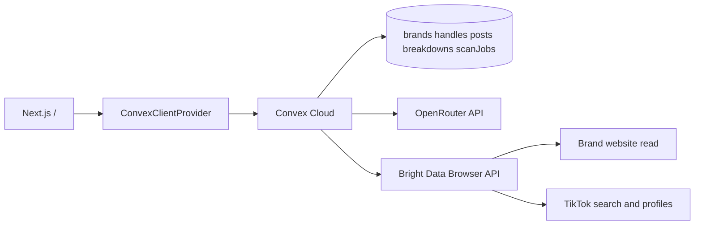

# Viralradar — live operation

Operational reference for this Next.js + Convex app.  
Local dev: [README.md](../README.md). Session history: [JOURNAL.md](JOURNAL.md). Agent conventions: [AGENT-CONVENTIONS.md](AGENT-CONVENTIONS.md).

## Current state

| Item | Value |
|------|--------|
| Path | `c:\flutter_apps\viralradar` |
| Org / repo | [sid-kiwilab/viralradar](https://github.com/sid-kiwilab/viralradar) |
| Product | **Viral Radar** — organic outlier short-form signal (TikTok first) |
| Domain | unset |
| Stack | Next.js 16, React 19, Tailwind 4, Convex, `playwright-core` (remote CDP), OpenRouter (`openai` SDK) |
| App root | `app/` (no `src/`) |
| Dev server | `npm run dev` or [`start.bat`](../start.bat) → owner verifies in browser |
| Routes | `/`, `/post/[postId]` (breakdown placeholder) |
| Backend | Convex Cloud (`convex/`) |
| LLM | OpenRouter → default `anthropic/claude-sonnet-4.6` ([`convex/lib/openrouter.ts`](../convex/lib/openrouter.ts)); optional `OPENROUTER_MODEL` on Convex |
| Scraper | Bright Data Browser API via `connectOverCDP` ([`convex/scraper/browser.ts`](../convex/scraper/browser.ts), [`convex/scraper/tiktok.ts`](../convex/scraper/tiktok.ts)) |
| Production URL | unset |

### Git (this repo only)

| Setting | Value |
|---------|--------|
| Branch | `main` |
| `origin` | `github.com/sid-kiwilab/viralradar` |
| Local user | `sid-kiwilab` / `sid@kiwilab.ai` |

---

## Architecture



- **Home** ([`app/home-client.tsx`](../app/home-client.tsx)): stepped scan with pauses. Paste a URL and **Scan** (URL field required each time; last `brandId` may restore from `sessionStorage`). Flow: `brands.startFromUrl` → review brand → `scanJobs.continueToCompetitors` → review checkboxes → `scanJobs.searchConfirmedCompetitors` → outlier list. **`scanJobs.abandonScan`** cancels `pending`, `running`, or `waiting` steps.
- **Scan pipeline** ([`convex/actions/scanBrand.ts`](../convex/actions/scanBrand.ts)): three internal actions (`readSite`, `inferCompetitors`, `searchTikTok`). Stages: `understand_site` → `review_brand` (`waiting`) → `find_competitors` → `review_competitors` (`waiting`) → `search_tiktok` → `score` → `done` (or `failed`).
- **Site read**: cookie-banner block, captcha wait, one retry; page text only (no raw `fetch` of the brand URL).
- **Competitors**: OpenRouter from stored page excerpt (max 5); user confirms names before TikTok runs.
- **TikTok / Bright Data**: TikTok requires Browser zone [KYC](https://brightdata.com/cp/kyc) approval. Compliance blocks surface as a short message via [`convex/lib/scraperErrors.ts`](../convex/lib/scraperErrors.ts).
- **Scoring**: median views per handle (min 5 posts) → `outlierScore` = views / baseline ([`convex/scoring.ts`](../convex/scoring.ts)).
- **Still stub**: [`breakdowns.getOrCreate`](../convex/breakdowns.ts).
- **Gitignore**: `.env*`, `node_modules/`, `.next/`, `.vercel/`, `.convex/`, `/tmp/`, Playwright reports.

---

## Environment variables

### Next.js (`.env.local`, gitignored)

Do not put `OPENROUTER_API_KEY` or `BRIGHTDATA_*` here. Convex actions read deployment env only.

| Variable | Required | Purpose |
|----------|----------|---------|
| `NEXT_PUBLIC_CONVEX_URL` | Yes for UI | Convex deployment URL |
| `CONVEX_DEPLOYMENT` | Yes for CLI | Set by `npx convex dev` |

### Convex deployment (`npx convex env set`)

| Variable | Required | Purpose |
|----------|----------|---------|
| `OPENROUTER_API_KEY` | For LLM steps | OpenRouter API key |
| `OPENROUTER_MODEL` | Optional | OpenRouter model id (default `anthropic/claude-sonnet-4.6`) |
| `BRIGHTDATA_BROWSER_WSS` | For scrape | Full Playwright CDP URL from Browser API “Copy command” |
| `BRIGHTDATA_BROWSER_USERNAME` | Optional split | e.g. `brd-customer-…-zone-scraping_browser1` |
| `BRIGHTDATA_BROWSER_PASSWORD` | Optional split | Zone password from copy command (may ≠ account API key) |

Node actions mark `playwright-core` and `chromium-bidi` as external in [`convex.json`](../convex.json).

### Vercel (when deploying)

| Variable | Purpose |
|----------|---------|
| `NEXT_PUBLIC_CONVEX_URL` | Production Convex URL |
| `CONVEX_DEPLOY_KEY` | `npx convex deploy --cmd "next build"` |

Placeholders: [`.env.example`](../.env.example).

---

## Key files

| File | Role |
|------|------|
| [`app/home-client.tsx`](../app/home-client.tsx) | Scan UI, job progress, ranked posts |
| [`convex/brands.ts`](../convex/brands.ts) | `startFromUrl`, brand patch after LLM |
| [`convex/scanJobs.ts`](../convex/scanJobs.ts) | `latestByBrand`, `continueToCompetitors`, `searchConfirmedCompetitors`, `abandonScan`, patches |
| [`lib/scraperErrorHints.ts`](../lib/scraperErrorHints.ts) | Client hint when error is Bright Data TikTok KYC |
| [`convex/actions/scanBrand.ts`](../convex/actions/scanBrand.ts) | Stepped scan internal actions |
| [`convex/lib/scraperErrors.ts`](../convex/lib/scraperErrors.ts) | User-facing Bright Data error text |
| [`convex/discovery/brandFromUrl.ts`](../convex/discovery/brandFromUrl.ts) | Brand inference from page text |
| [`convex/discovery/competitorsFromBrand.ts`](../convex/discovery/competitorsFromBrand.ts) | Competitor list (max 5) |
| [`convex/scraper/browser.ts`](../convex/scraper/browser.ts) | Bright Data page fetch helper |
| [`convex/scraper/tiktok.ts`](../convex/scraper/tiktok.ts) | TikTok search + profile scrape |
| [`convex/posts.ts`](../convex/posts.ts) | Upsert posts, `rankedByBrand` |
| [`convex/scoring.ts`](../convex/scoring.ts) | Median baseline and multiplier |
| [`convex/breakdowns.ts`](../convex/breakdowns.ts) | Breakdown stub |
| [`start.bat`](../start.bat) | Windows dev entry (`npm run dev`) |

---

## Local testing

```bash
cd c:\flutter_apps\viralradar
npx convex dev
npm run dev
npm run build
npm run lint
npm run convex:codegen
```

Owner verifies UI in the browser: Scan → confirm brand → Find competitors → confirm list → Search TikTok. Agents do not fetch localhost ([AGENT-CONVENTIONS.md](AGENT-CONVENTIONS.md)).

---

## Deploy checklist

- [x] Git remote
- [x] Convex **dev** push (`npx convex dev --once` on `mellow-mule-141`). Production `npx convex deploy` only if the owner asked to ship
- [x] Convex dev env set (`OPENROUTER_API_KEY`, `BRIGHTDATA_BROWSER_*`)
- [ ] Vercel linked + preview deploy
- [ ] Production Convex + `CONVEX_DEPLOY_KEY` on Vercel
