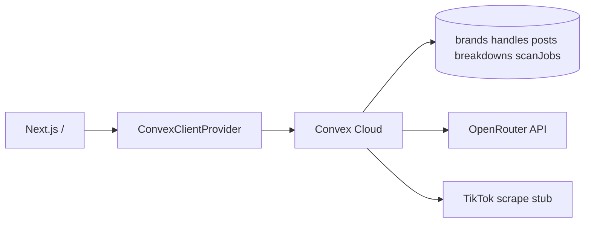

# Viralradar — live operation

Operational reference for this Next.js + Convex app.  
Local dev: [README.md](../README.md). Session history: [JOURNAL.md](JOURNAL.md). Agent conventions: [AGENT-CONVENTIONS.md](AGENT-CONVENTIONS.md).

## Current state

| Item | Value |
|------|--------|
| Path | `c:\flutter_apps\viralradar` |
| Org / repo | [sid-kiwilab/viralradar](https://github.com/sid-kiwilab/viralradar) |
| Product | **Viral Radar** — organic outlier short-form signal (TikTok first) |
| Domain | unset |
| Stack | Next.js 16, React 19, Tailwind 4, Convex, Playwright, OpenRouter (`openai` SDK) |
| App root | `app/` (no `src/`) |
| Dev server | `npm run dev` or [`start.bat`](../start.bat) → owner verifies in browser |
| Routes | `/`, `/post/[postId]` (breakdown placeholder) |
| Backend | Convex Cloud (`convex/`) |
| LLM | OpenRouter → default `anthropic/claude-sonnet-4` ([`convex/lib/openrouter.ts`](../convex/lib/openrouter.ts)) |
| Scraper | Stub ([`convex/scraper/tiktok.ts`](../convex/scraper/tiktok.ts)); planned path is Playwright `connectOverCDP` to Bright Data Browser API |
| Production URL | unset |

### Git (this repo only)

| Setting | Value |
|---------|--------|
| Branch | `main` |
| `origin` | `github.com/sid-kiwilab/viralradar` |
| Local user | `sid-kiwilab` / `sid@kiwilab.ai` |

---

## Architecture



- **Home** ([`app/home-client.tsx`](../app/home-client.tsx)): brand URL input (scan disabled until pipeline ships). Health query runs after mount, under one shared Convex client ([`app/ConvexClientProvider.tsx`](../app/ConvexClientProvider.tsx)).
- **Convex schema** ([`convex/schema.ts`](../convex/schema.ts)): brands, handles, posts, breakdowns, scanJobs.
- **Stubs**: discovery actions, `actions/scanBrand`, `breakdowns.getOrCreate`, TikTok scraper.
- **Gitignore**: `.env*`, `node_modules/`, `.next/`, `.vercel/`, `.convex/`, `/tmp/`, Playwright reports.

---

## Environment variables

### Next.js (`.env.local`, gitignored)

Do not put `OPENROUTER_API_KEY` or `BRIGHTDATA_*` here. Convex actions read deployment env only.

| Variable | Required | Purpose |
|----------|----------|---------|
| `NEXT_PUBLIC_CONVEX_URL` | Yes for UI | Convex deployment URL |
| `CONVEX_DEPLOYMENT` | Yes for CLI | Set by `npx convex dev` |

### Convex deployment (`npx convex env set`)

| Variable | Required | Purpose |
|----------|----------|---------|
| `OPENROUTER_API_KEY` | For LLM steps | OpenRouter API key |
| `BRIGHTDATA_BROWSER_WSS` | For scrape | Full Playwright CDP URL from Browser API “Copy command” |
| `BRIGHTDATA_BROWSER_USERNAME` | Optional split | e.g. `brd-customer-…-zone-scraping_browser1` |
| `BRIGHTDATA_BROWSER_PASSWORD` | Optional split | Zone password from copy command (may ≠ account API key) |

### Vercel (when deploying)

| Variable | Purpose |
|----------|---------|
| `NEXT_PUBLIC_CONVEX_URL` | Production Convex URL |
| `CONVEX_DEPLOY_KEY` | `npx convex deploy --cmd "next build"` |

Placeholders: [`.env.example`](../.env.example).

---

## Key files

| File | Role |
|------|------|
| [`app/ConvexClientProvider.tsx`](../app/ConvexClientProvider.tsx) | Single Convex client; wraps the app when `NEXT_PUBLIC_CONVEX_URL` is set |
| [`app/layout.tsx`](../app/layout.tsx) | Dark shell, Convex provider |
| [`app/home-client.tsx`](../app/home-client.tsx) | URL input, health query |
| [`convex/schema.ts`](../convex/schema.ts) | Data model |
| [`convex/health.ts`](../convex/health.ts) | Trivial wiring query |
| [`convex/lib/openrouter.ts`](../convex/lib/openrouter.ts) | OpenRouter client helper |
| [`convex/scraper/tiktok.ts`](../convex/scraper/tiktok.ts) | TikTok scrape stub (Browser API WSS) |
| [`convex/scoring.ts`](../convex/scoring.ts) | Outlier score math (baseline TBD) |
| [`convex/posts.ts`](../convex/posts.ts) | `rankedByBrand` (scored posts, pool cap 2000) |
| [`convex/breakdowns.ts`](../convex/breakdowns.ts) | `byPost` query, `getOrCreate` action stub |
| [`start.bat`](../start.bat) | Windows dev entry (`npm run dev`) |
| [`.gitignore`](../.gitignore) | Local secrets and build artifacts |

---

## Local testing

```bash
cd c:\flutter_apps\viralradar
npx convex dev
npm run dev
npm run build
npm run lint
npm run convex:codegen
```

Owner verifies UI in the browser. Agents do not fetch localhost ([AGENT-CONVENTIONS.md](AGENT-CONVENTIONS.md)).

---

## Deploy checklist

- [x] Git remote
- [x] Convex **dev** push (`npx convex dev --once` on `mellow-mule-141`, 2026-10-24). Production `npx convex deploy` only if the owner asked to ship
- [x] Convex dev env set (`OPENROUTER_API_KEY`, `BRIGHTDATA_BROWSER_*`, `BRIGHTDATA_API_KEY`)
- [ ] Vercel linked + preview deploy
- [ ] Production Convex + `CONVEX_DEPLOY_KEY` on Vercel
