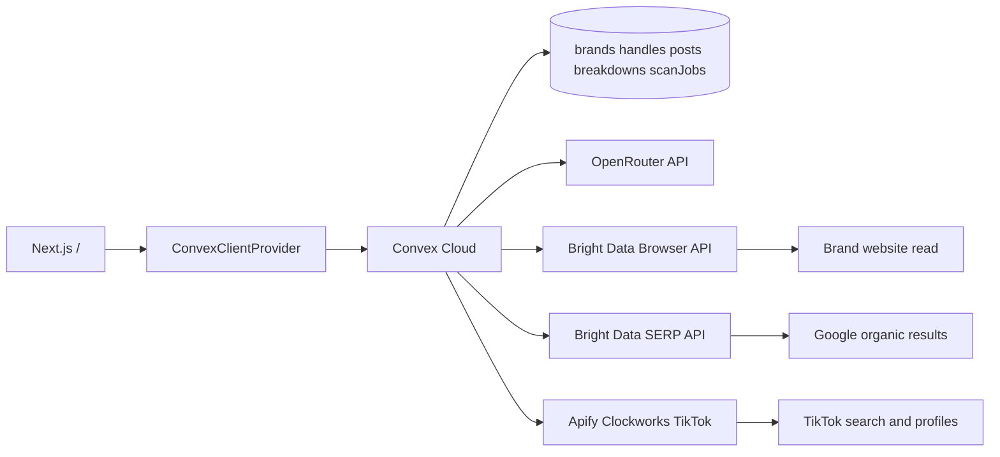

# Viralradar: live operation

Operational reference for this Next.js + Convex app.  
Local dev: [README.md](../README.md). Session history: [JOURNAL.md](JOURNAL.md).

## Current state

| Item | Value |
|------|--------|
| Path | `c:\flutter_apps\viralradar` |
| Org / repo | [sid-kiwilab/viralradar](https://github.com/sid-kiwilab/viralradar) |
| Product | **Viral Radar**: organic outlier short-form signal (TikTok first) |
| Domain | unset |
| Stack | Next.js 16, React 19, Tailwind 4, Convex, `playwright-core` (remote CDP), OpenRouter (`openai` SDK) |
| App root | `app/` (no `src/`) |
| Dev server | `npm run dev` or [`start.bat`](../start.bat) → owner verifies in browser |
| Routes | `/`, `/how-it-works`, `/post/[postId]` (cached structural brief) |
| Backend | Convex Cloud (`convex/`) |
| LLM | OpenRouter → default `anthropic/claude-sonnet-4.6` ([`convex/lib/openrouter.ts`](../convex/lib/openrouter.ts)); optional `OPENROUTER_MODEL` on Convex |
| Scraper | Brand sites: Bright Data Browser API. Competitors: Bright Data **SERP API** (optional; memory fallback). TikTok: **Apify Clockworks today**; Bright Data TikTok planned for unit economics ([`convex/scraper/apifyTikTok.ts`](../convex/scraper/apifyTikTok.ts), [`convex/scraper/tiktok.ts`](../convex/scraper/tiktok.ts)) |
| Production URL | unset |

### Git (this repo only)

| Setting | Value |
|---------|--------|
| Branch | `main` |
| `origin` | `github.com/sid-kiwilab/viralradar` |
| Local user | `sid-kiwilab` / `sid@kiwilab.ai` |

---

## Architecture



- **Home** ([`app/home-client.tsx`](../app/home-client.tsx)): Idle landing when no `brandId`/`jobId` (hero, **`TryBrandChips`** / Instant results for Gymshark/Duolingo/Oatly, default URL `duolingo.com`, bare-host brand input, demo footer via [`landing-below-fold.tsx`](../components/landing-below-fold.tsx)); **Walkthrough** when `TELLA_EMBED_URL` set. Primary CTA: **Fast scan** when input matches a Try host ([`isInstantTryBrandInput`](../lib/demo-brands.ts)), else **Scan**. **`startFromUrl`**: Try hosts reopen last **completed** job; other URLs always **live** scan ([`convex/brands.ts`](../convex/brands.ts)). Reset/home restores default URL. Client pins `jobId` via [`scanJobs.getById`](../convex/scanJobs.ts) (`Loading scan…` while pending); completed outlier list hidden while **`submitting`** a new scan. **`review_competitors`**: confirm disclaimer; select all/none; **Search N TikTok account(s)**. Parallel scrape + skeletons; outliers ≥2× / 90d; [`PostThumbnail`](../components/post-thumbnail.tsx). Header → [`/how-it-works`](../app/how-it-works/page.tsx).
- **Scan job patches** ([`convex/scanJobs.ts`](../convex/scanJobs.ts)): internal **`patch`** and **`markRunning`** no-op when job is already `failed` or `completed` (stale actions after cancel/rescan).
- **Scan pipeline** ([`convex/actions/scanBrand.ts`](../convex/actions/scanBrand.ts)): two internal actions (`readSite`, `searchTikTok`). Stages: `understand_site` → `find_competitors` → `review_competitors` (`waiting`) → `search_tiktok` → `score` → `done` (or `failed`). **`isJobActive`** after each long await and before TikTok upserts / `completed`; [`patchFromScan`](../convex/brands.ts) no-ops unless the job is active and matches `brandId`.
- **Site read**: cookie-banner block, captcha wait, one retry; page text only (no raw `fetch` of the brand URL).
- **Competitors**: When **`BRIGHTDATA_API_KEY`** + **`BRIGHTDATA_SERP_ZONE`** are set, OpenRouter builds 3 Google queries → Bright Data **SERP API** Direct API (`data_format: json`, organic title/link/snippet) → OpenRouter extracts up to 5 names **only from those results** ([`discoverCompetitors`](../convex/discovery/competitorsFromBrand.ts), [`brightDataSerp.ts`](../convex/scraper/brightDataSerp.ts)). SERP errors or empty results fall back to a memory-based list; fallback reason is stored on `scanJobs.detail` for confirm. With **`APIFY_API_KEY`**, one batched Apify user search resolves names (`foundVia: search` on [`proposedAccounts`](../convex/schema.ts)); [`pickAccountForName`](../convex/scraper/apifyTikTok.ts) prefers exact handle/display over prefix matches. Without Apify, only a `tiktok.com/@…` link on each competitor homepage (`foundVia: site`). Niche creators from video search + [`filterTikTokAccounts`](../convex/discovery/filterTikTokAccounts.ts).
- **TikTok**: After confirm, checked handles scrape latest 24 videos via `clockworks/tiktok-scraper` in **parallel** (`Promise.allSettled` per handle); each success upserts and recomputes scores immediately. `confirmedHandles` / `scrapeHandlesCompleted` on [`scanJobs`](../convex/schema.ts). Job completes if any handle returns posts; partial failures on `job.detail`. **No video download**; **cover images** fetched server-side at scrape into Convex file storage (`posts.thumbnailStorageId`, [`storeThumbnail.ts`](../convex/lib/storeThumbnail.ts)); demo reopen schedules [`backfillForBrand`](../convex/actions/thumbnails.ts) for legacy rows. Bright Data is for site read (+ SERP), not TikTok when Apify is set.
- **Scoring**: median views per handle (min 5 posts) → `outlierScore` = views / baseline ([`convex/scoring.ts`](../convex/scoring.ts)). **Display** ([`posts.rankedByBrand`](../convex/posts.ts)): last 90 days, score ≥ 2×, sorted by multiplier.
- **Breakdown**: [`/post/[postId]`](../app/post/[postId]/page.tsx). One OpenRouter call per post (cached in `breakdowns` on revisit). UI: outlier / recreatability / confidence with [`ScoreTip`](../components/score-tip.tsx) tooltips; link to `/how-it-works`. Metadata-only brief ([`discovery/breakdownFromPost.ts`](../convex/discovery/breakdownFromPost.ts)).
- **Gitignore**: `.env*`, `node_modules/`, `.next/`, `.vercel/`, `.convex/`, `/tmp/`, Playwright reports.

---

## Environment variables

### Next.js (`.env.local`, gitignored)

Do not put `OPENROUTER_API_KEY`, `APIFY_API_KEY`, or `BRIGHTDATA_*` here. Convex actions read deployment env only.

| Variable | Required | Purpose |
|----------|----------|---------|
| `NEXT_PUBLIC_CONVEX_URL` | Yes for UI | Convex deployment URL |
| `CONVEX_DEPLOYMENT` | Yes for CLI | Set by `npx convex dev` |

### Convex deployment (`npx convex env set`)

| Variable | Required | Purpose |
|----------|----------|---------|
| `OPENROUTER_API_KEY` | For LLM steps | OpenRouter API key |
| `OPENROUTER_MODEL` | Optional | OpenRouter model id (default `anthropic/claude-sonnet-4.6`) |
| `APIFY_API_KEY` | For TikTok | Apify token; runs `clockworks/tiktok-scraper` |
| `BRIGHTDATA_BROWSER_WSS` | For site read | Full Playwright CDP URL from Browser API “Copy command” |
| `BRIGHTDATA_BROWSER_USERNAME` | Optional split | e.g. `brd-customer-…-zone-scraping_browser1` |
| `BRIGHTDATA_BROWSER_PASSWORD` | Optional split | Zone password from copy command (may ≠ account API key) |
| `BRIGHTDATA_API_KEY` | For live competitors | Account API key from Bright Data (SERP Direct API) |
| `BRIGHTDATA_SERP_ZONE` | For live competitors | SERP API zone name (not the Browser zone) |

Node actions mark `playwright-core` and `chromium-bidi` as external in [`convex.json`](../convex.json).

### Vercel (when deploying)

| Variable | Purpose |
|----------|---------|
| `NEXT_PUBLIC_CONVEX_URL` | Production Convex URL |
| `CONVEX_DEPLOY_KEY` | `npx convex deploy --cmd "next build"` |

Placeholders: [`.env.example`](../.env.example).

---

## Key files

| File | Role |
|------|------|
| [`app/layout.tsx`](../app/layout.tsx) | Root layout; `metadata.referrer: no-referrer` for outbound links |
| [`app/home-client.tsx`](../app/home-client.tsx) | Landing + scan UI, `TryBrandChips`, Fast scan label, job pin, ranked posts |
| [`components/tiktok-external-link.tsx`](../components/tiktok-external-link.tsx) | Outbound TikTok anchors (`no-referrer`) |
| [`convex/lib/tiktokUrls.ts`](../convex/lib/tiktokUrls.ts) | Canonical profile/video URLs + sanitize for stored links |
| [`components/site-header.tsx`](../components/site-header.tsx) | Wordmark link (post page) or home reset button |
| [`components/site-shell.tsx`](../components/site-shell.tsx) | Hero video, grain, header shell |
| [`components/scan-status.tsx`](../components/scan-status.tsx) | Radar animation + stage chips during scan |
| [`components/landing-below-fold.tsx`](../components/landing-below-fold.tsx) | Idle landing footer (demo + how-it-works link) |
| [`lib/demo-brands.ts`](../lib/demo-brands.ts) | Try hosts, `DEFAULT_TRY_BRAND_INPUT`, `isInstantTryBrandInput` (Fast scan label) |
| [`lib/site-constants.ts`](../lib/site-constants.ts) | Hero video, re-exports Try URLs, `TELLA_EMBED_URL` |
| [`components/post-thumbnail.tsx`](../components/post-thumbnail.tsx) | Stored cover URL; remount on URL change; placeholder on error |
| [`components/score-tip.tsx`](../components/score-tip.tsx) | Breakdown score definition tooltips |
| [`app/how-it-works/page.tsx`](../app/how-it-works/page.tsx) | Methodology page (real stack) |
| [`components/walkthrough-slot.tsx`](../components/walkthrough-slot.tsx) | Landing Tella embed placeholder |
| [`components/site-header.tsx`](../components/site-header.tsx) | Wordmark + How it works link |
| [`convex/lib/demoBrands.ts`](../convex/lib/demoBrands.ts) | Demo host match helpers (imports [`lib/demo-brands.ts`](../lib/demo-brands.ts)) |
| [`convex/actions/thumbnails.ts`](../convex/actions/thumbnails.ts) | Backfill stored covers for demo cache reopen |
| [`convex/lib/storeThumbnail.ts`](../convex/lib/storeThumbnail.ts) | Fetch TikTok cover into Convex storage at scrape |
| [`convex/lib/postThumbnail.ts`](../convex/lib/postThumbnail.ts) | Resolve `thumbnailUrl` for queries |
| [`lib/stageLabel.ts`](../lib/stageLabel.ts) | Scan stage status copy |
| [`app/globals.css`](../app/globals.css) | Landing design tokens (NASC / Mog Check subset) |
| [`convex/brands.ts`](../convex/brands.ts) | `startFromUrl` (Try hosts only: reopen completed scan; else live scan; fail active jobs), `patchFromScan` |
| [`convex/scanJobs.ts`](../convex/scanJobs.ts) | `getById`, `latestByBrand` (newest `startedAt`), `searchConfirmedCompetitors`, `abandonScan`, guarded internal patches |
| [`convex/lib/proposedAccount.ts`](../convex/lib/proposedAccount.ts) | Validator for proposed TikTok rows on scan jobs |
| [`convex/scraper/tiktokLinks.ts`](../convex/scraper/tiktokLinks.ts) | Parse `tiktok.com/@…` from page links (no-Apify competitor path) |
| [`convex/discovery/filterTikTokAccounts.ts`](../convex/discovery/filterTikTokAccounts.ts) | LLM relevance filter for niche creator candidates |
| [`convex/discovery/nicheSearchQueries.ts`](../convex/discovery/nicheSearchQueries.ts) | Niche TikTok video search queries from brand context |
| [`lib/scraperErrorHints.ts`](../lib/scraperErrorHints.ts) | Client hint when error is Bright Data TikTok KYC |
| [`convex/actions/scanBrand.ts`](../convex/actions/scanBrand.ts) | Stepped scan internal actions |
| [`convex/lib/scraperErrors.ts`](../convex/lib/scraperErrors.ts) | User-facing Bright Data error text |
| [`convex/discovery/brandFromUrl.ts`](../convex/discovery/brandFromUrl.ts) | Brand inference from page text |
| [`convex/discovery/competitorsFromBrand.ts`](../convex/discovery/competitorsFromBrand.ts) | SERP + fallback competitor discovery |
| [`convex/discovery/competitorSearchQueries.ts`](../convex/discovery/competitorSearchQueries.ts) | Google queries for competitor SERP |
| [`convex/scraper/brightDataSerp.ts`](../convex/scraper/brightDataSerp.ts) | Bright Data SERP organic results |
| [`convex/scraper/browser.ts`](../convex/scraper/browser.ts) | Bright Data page fetch helper |
| [`convex/scraper/apifyTikTok.ts`](../convex/scraper/apifyTikTok.ts) | Clockworks TikTok search + profile via Apify |
| [`convex/scraper/tiktok.ts`](../convex/scraper/tiktok.ts) | TikTok entry: Apify if keyed, else Bright Data |
| [`convex/posts.ts`](../convex/posts.ts) | Upsert posts, `rankedByBrand` |
| [`convex/scoring.ts`](../convex/scoring.ts) | Median baseline and multiplier |
| [`convex/breakdowns.ts`](../convex/breakdowns.ts) | Breakdown queries + cache insert |
| [`convex/actions/breakdownPost.ts`](../convex/actions/breakdownPost.ts) | OpenRouter structural brief action |
| [`convex/discovery/breakdownFromPost.ts`](../convex/discovery/breakdownFromPost.ts) | Breakdown LLM prompt |
| [`app/post/[postId]/post-breakdown-client.tsx`](../app/post/[postId]/post-breakdown-client.tsx) | Brief UI + retry |
| [`lib/formatMetrics.ts`](../lib/formatMetrics.ts) | Views / multiplier formatting |
| [`start.bat`](../start.bat) | Windows dev entry (`npm run dev`) |

---

## Local testing

```bash
cd c:\flutter_apps\viralradar
npx convex dev
npm run dev
npm run build
npm run lint
npm run convex:codegen
```

Owner verifies UI in the browser: idle landing (prefilled `duolingo.com`, **Fast scan**) → confirm accounts (check scan status line for Google vs fallback competitors; open `@handle` links, uncheck wrong guesses) → Search TikTok → outlier list → **Breakdown** on a row. Try another Instant chip or a live URL (**Scan**). Refresh, wordmark, or Cancel scan returns to idle landing with default URL; no brand panel during site read. No footer notice when Convex is healthy. Agents do not fetch localhost.

---

## Deploy checklist

- [x] Git remote
- [x] Convex **dev** push (`npx convex dev --once` on `mellow-mule-141`). Production `npx convex deploy` only if the owner asked to ship
- [x] Convex dev env set (`OPENROUTER_API_KEY`, `APIFY_API_KEY`, `BRIGHTDATA_BROWSER_*`, `BRIGHTDATA_API_KEY`, `BRIGHTDATA_SERP_ZONE` for live competitors)
- [ ] Vercel linked + preview deploy
- [ ] Production Convex + `CONVEX_DEPLOY_KEY` on Vercel
